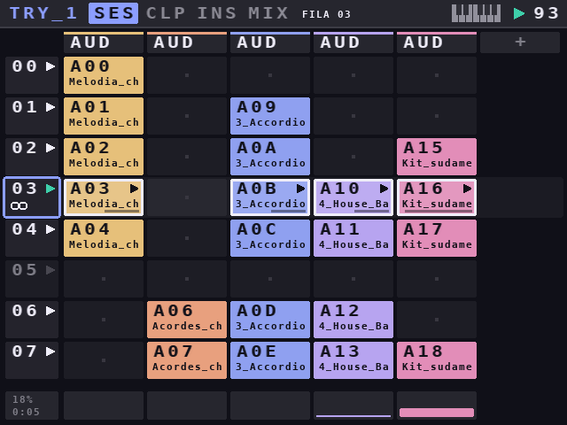

# Chancho 6

**Un tracker de bolsillo con una Session como la de Ableton Live**, para consolas portátiles
Anbernic. Es un fork de [Little Piggy Tracker](https://github.com/djdiskmachine/LittleGPTracker)
(antes LittleGPTracker).

> **ALPHA.** Chancho 6 se hace y se prueba en una **RG353V** con dArkOS. La versión para la
> **RG35XX Plus** está compilada pero **nadie la ha probado todavía en esa consola**.
> Haz copia de tus proyectos.



## Descargar

En [Releases](https://github.com/ernestomalaca/chancho6/releases) está el zip de cada consola.
Trae el programa, un set demo (`chancho_try`) y un manual en PDF.

| Consola | Sistema | Estado |
|---|---|---|
| Anbernic RG353V | dArkOS, ROCKNIX | alpha, probada en la consola |
| Anbernic RG35XX Plus | muOS, Knulli | alpha, **sin probar** |

Instalar: copia los `.sh` y la carpeta `chancho6/` a la carpeta de Ports de la tarjeta y abre
**Ports › Chancho 6**.

## Qué tiene

- **Session como Live.** Clips por pista y escenas que entran en el siguiente compás, y Stop All Clips.
  Las escenas pueden repetirse xN y seguir a la escena de abajo.
- **Clips de audio** estirados a tempo (complex / re-pitch), hasta 191 por proyecto.
- **Samples, kits y multicapa**, con un navegador de sonidos y pre-escucha.
- **Teclado MIDI por USB** (RG353V) y Capture, como en Live.
- **Ableton Link**, para seguir el tempo de Live.
- **chancho.local**: sube samples, baja proyectos y exporta a Ableton Live desde el navegador.
- **live2chancho** (`tools/live2chancho`): pasa un set de Live con pistas de audio a un proyecto de Chancho.

El detalle de los controles está en el manual y en
[`projects/resources/RG353V/LEEME.txt`](projects/resources/RG353V/LEEME.txt).

## Compilar

Con el SDK de la RG35XX Plus en `/opt/rg35xx-plus-aarch64-SDL2-SDK-0.1.0`:

```
cd projects/resources/RG353V && bash empaquetar.sh        # RG353V
cd projects/resources/RG35XXPLUS && bash empaquetar.sh    # RG35XX Plus
```

## Créditos

- **Ernesto Malaca** ([@ernestomalaca](https://github.com/ernestomalaca)): idea, diseño y pruebas en la consola.
- **Claude** (Anthropic): programación, como coautor de los commits de Chancho.
- Little Piggy Tracker: **djdiskmachine** y sus colaboradores. LittleGPTracker: **Marc Nostromo** (m-.-n).

## Licencia

GPLv3, igual que Little Piggy Tracker ([LICENSE](LICENSE)). El código original es de
Marc Nostromo (m-.-n), y el fork que lo continúa es de djdiskmachine. El README de Little Piggy
Tracker está en [docs/README-littlepiggy.md](docs/README-littlepiggy.md).
